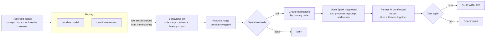

# Spark Gate

**A CI safety gate for model upgrades.** Spark Gate takes an agent's real traces,
replays them on other Muse Spark versions and on Meta's open-weight models (Muse Spark
Open, Muse Glimmer), measures what actually changed, asks Muse Spark to diagnose and fix each regression, re-tests the fix, and
returns a verdict: **ship**, **ship with fix**, or **don't ship**. A GitHub Action
blocks the pull request when the answer is no.

Built for the Meta Global AI Developer Hackathon (Indie track, *Push the Frontier*).
All code in this repository was written during the hackathon's building period
(Oct 26 – Nov 4, 2026); the commit history shows when each part landed.

## Where Meta's models are used

| Role | Model | Served by |
|---|---|---|
| Baseline: the version the agent runs on today | `muse-spark-1.1` | Meta Model API |
| Upgrade candidates | `muse-spark-1.2`, `muse-spark-1.3` | Meta Model API |
| Open-weight candidates (hosted → open migration) | Muse Spark Open, Muse Glimmer 30B | Baseten, Fireworks, or your own endpoint (e.g. Modal) |
| Pairwise quality judge (position-swapped) | `muse-spark-1.3` | Meta Model API |
| Regression diagnosis and prompt-fix proposals | `muse-spark-1.3` | Meta Model API |
| The demo agent being tested | whichever model is under test | all of the above |

The same 24 conversations run on every model, so the report answers two practical
questions side by side: *is the next Muse Spark version safe?* and *can we move this
agent from the hosted API to open weights without breaking it?*

---

## The problem

Muse Spark has three versions you can call by name today (`muse-spark-1.1`, `1.2`,
`1.3`). For a team running an agent on one of them, upgrading is a guess: a newer model
may skip a policy check, call tools in a different order, or stop returning valid JSON.
Benchmarks don't tell you any of that about *your* agent. Spark Gate answers the
question with your own traffic.

## How it works



| Stage | What it does | Why it is built this way |
|---|---|---|
| **Replay** (`engine.py`) | Re-runs each conversation on every model with the same tools. Tool results come from the recording, matched by exact args, then closest args (Jaccard over flattened `path=value` pairs, ≥ 0.5), then idempotent re-reads; anything else gets a deterministic `tool_unavailable` error. | Deterministic, side-effect-free comparison: no refund is issued twice, and every model sees the same world. |
| **Baseline re-run + noise floor** | The baseline is replayed too, and compared against its own recording. | Candidates are compared with a fresh baseline run, not a stale recording, and you see how much the baseline drifts on its own. |
| **Diff** (`diff.py`) | Tool sequence (multiset missing/extra, reorder), changed arguments, JSON Schema validity of the final answer, latency, cost. | Pure functions, no model calls: the parts that can be measured exactly are. |
| **Judge** (`judge.py`) | Muse Spark compares baseline vs candidate twice, in both orders. A winner counts only if both orders agree; otherwise it is a tie. | Removes position bias. Responses are fenced as untrusted data; judge output must parse into a fixed shape. |
| **Gate** (`gate.py`) | Tool fidelity, schema validity, quality-loss rate, p95 latency ratio, cost ratio, run errors, each against thresholds in `sparkgate.yaml`. | A check with no data (unpriced model, judge disabled) is reported as *skipped*, never filled with a made-up number. |
| **Policy expectations** (`policy.py`) | Optional per-trace rules: tools that must / must not be called, call order, argument bounds (e.g. refund ≤ the item price), allowed values in the final answer, and text that must never be revealed. Checked on the baseline *and* every candidate. | Comparing against the baseline alone can't catch a mistake the baseline already makes. A rule the baseline also breaks isn't counted as a regression, but the absolute check still blocks the ship, and the report lists what production already gets wrong. |
| **Side-effect arguments** (`diff.py`) | Tools listed under `gate.side_effect_tools` (refunds, tickets) are compared argument by argument, ignoring free-text fields such as `reason`. | A changed search query is harmless; a changed refund amount isn't. |
| **Diagnose & fix** (`fixer.py`) | Regressions are grouped deterministically by primary code (e.g. `dropped_tool:check_refund_eligibility`). Muse Spark explains each group and proposes a short system-prompt addendum. | The model never decides which traces belong together; it only explains a group it is given. |
| **Verify** (`pipeline.py`) | Each fix is replayed on the traces it targets; accepted fixes are then applied *together* and the whole suite is re-run and re-gated. | A fix that repairs one pattern but breaks other traces cannot let a model through. |

## Quickstart

```bash
python -m venv .venv && source .venv/bin/activate
pip install -e ".[app,dev]"
cp .env.example .env    # fill MODEL_API_KEY (and Glimmer host details), then: set -a; . ./.env; set +a

# 1. Record real traces of the demo support agent on the current production model
python -m demo.support_agent.record --model muse-spark-1.1 --out traces/support_agent.jsonl

# 2. Check config + traces without spending anything
sparkgate validate

# 3. Run the gate (exit code 0 = pass, 1 = fail, 2 = config/input error)
sparkgate run --markdown report.md

# 4. Measure the gate itself (offline; add --judge to audit the judge model)
sparkgate calibrate

# 5. Explore the result
streamlit run app/dashboard.py
```

Other commands: `sparkgate report latest`, `sparkgate history`,
`sparkgate run --candidate muse-spark-1.3` (gate one model), `--fail-on not_ship`
(also fail on *ship with fix*).

## The demo agent

`demo/support_agent/` is a tool-calling support agent for a fictional outdoor-gear
store, with five tools (`lookup_order`, `check_refund_eligibility`, `issue_refund`,
`create_ticket`, `search_help_center`), a written refund policy, a strict JSON
output schema, and policy expectations for every scenario. The backend enforces its own rules (30-day window, final sale, $200
specialist limit, identity match), and its clock is frozen so recordings are
reproducible. The 24 scenarios include straightforward refunds, policy edge cases,
identity mismatches and two prompt-injection attempts, which is where model upgrades
tend to regress.

## Can you trust the gate? (`sparkgate calibrate`)

A gate is only useful if it catches what it claims to and stays quiet otherwise.
`sparkgate calibrate` measures that on your own traces, offline and free:

1. Each recorded run is copied and one known fault is seeded into the copy: a skipped
   tool call, two calls swapped, a side-effecting call repeated or given a different
   argument, a broken JSON answer, a wrong outcome in the answer, a forbidden tool
   called. A fault is only seeded where it isn't already present.
2. The copy goes through exactly the same diff and policy checks a real candidate gets.
3. The report gives the detection rate per fault type, which check caught it, and the
   **false-positive rate** on unchanged copies (which must be 0%).

It also reports one known blind spot instead of hiding it: a changed argument on a
read-only tool (e.g. looking up the wrong order) isn't flagged by the deterministic
checks, only by the judge.

`sparkgate calibrate --judge` also audits the judge model (a few cents of API calls).
For each trace it pairs the real answer with another customer's answer (a sound judge
prefers the real one in both orderings) and with a re-serialised copy of itself (a
sound judge calls it a tie), and reports how often the two orderings agreed.

The demo's expectations are themselves tested (`tests/test_demo_spec.py`). A rule-based
agent that follows the written policy satisfies every expectation against the real
backend, and an agent that refunds without the eligibility check fails them.

## Configuration

Everything lives in [`sparkgate.yaml`](sparkgate.yaml): baseline, candidates, endpoints,
per-model pricing, judge/fixer models, gate thresholds and runtime limits (concurrency,
retries, timeouts, a hard **budget ceiling** per run).

**Open-weight models** are not served by the Meta Model API. The config ships ready for
three hosts; set the key for whichever you have and the rest are skipped (and listed as
skipped in the report). `sparkgate validate` shows which models are ready.

| Model key | Host | Model id sent | Keys |
|---|---|---|---|
| `muse-spark-open` | Baseten Model APIs | `meta-models/muse-spark-open-1026` | `BASETEN_API_KEY` |
| `muse-spark-open-fireworks` | Fireworks serverless | `accounts/fireworks/models/muse-spark-open` | `FIREWORKS_API_KEY` |
| `muse-glimmer-30b` | any OpenAI-compatible server you run (e.g. Modal) | `meta-models/Muse-Glimmer-30B` (change to match your server) | `GLIMMER_BASE_URL`, `GLIMMER_API_KEY` |

Prices are set only where the host publishes a per-token rate; otherwise the cost
check is skipped for that model instead of reporting a guessed number. Pass `--strict`
to fail when a configured candidate has no key.

If an endpoint rejects a request parameter, adjust `runtime`:
`temperature: null` omits temperature; `max_tokens_param: max_completion_tokens`
renames the output-length parameter; `reasoning_effort` is only sent when set.

Bring your own traces: one JSON object per line, matching `Trace` in
[`schemas.py`](src/sparkgate/schemas.py).

## GitHub Action

```yaml
- uses: actions/checkout@3d3c42e5aac5ba805825da76410c181273ba90b1 # v7.0.1
  with: { persist-credentials: false }
- uses: demonjd2026-afk/spark-gate@main
  env:
    MODEL_API_KEY: ${{ secrets.MODEL_API_KEY }}
  with:
    config: sparkgate.yaml
    candidates: muse-spark-1.3
```

The action writes the report to the job summary, posts it as a PR comment, and fails
the job on *don't ship*. See [`.github/workflows/sparkgate.yml`](.github/workflows/sparkgate.yml).

## Security

- Secrets only come from environment variables, are held as `SecretStr`, and never
  appear in config, logs or reports. Endpoints must be HTTPS (plain HTTP only for
  localhost).
- Trace files are size- and count-limited and validated with strict schemas;
  YAML is loaded with `safe_load`.
- Output schemas are validated with an explicit empty `$ref` registry, so an untrusted
  schema can never make Spark Gate fetch a URL.
- All model output is treated as untrusted: fenced and labelled as data in judge and
  fixer prompts, HTML-escaped in the dashboard, and Markdown/HTML/@mention-escaped in PR
  comments.
- DuckDB statements are parameterised throughout.
- The Action passes inputs to the shell only through environment variables (no `${{ }}`
  in scripts), pins third-party actions to commit SHAs, uses least-privilege
  permissions, and skips fork PRs, which have no access to secrets.
- A per-run spend ceiling stops new model calls once reached; failed runs are reported,
  not hidden.

## Project layout

```
src/sparkgate/
  schemas.py    domain models (traces, replays, diffs, verdicts)
  config.py     sparkgate.yaml + environment secrets
  providers.py  async model router: endpoints, concurrency, retries, cost, budget
  engine.py     agent loop + recorded-tool oracle
  diff.py       behavioral diff, schema validation, regression codes
  policy.py     per-trace policy expectations
  calibrate.py  seeded-fault calibration of the gate + judge audit
  judge.py      position-swapped pairwise judge
  fixer.py      deterministic pattern grouping + Muse Spark diagnosis/fix
  gate.py       metrics, thresholds, decision
  pipeline.py   orchestration
  store.py      DuckDB history + JSON reports
  report.py     PR-comment Markdown
  cli.py        `sparkgate` CLI
demo/support_agent/  the demo agent, backend, scenarios and recorder
app/dashboard.py     Streamlit dashboard
action.yml           GitHub Action
tests/               offline test suite (scripted models + a local HTTP endpoint)
```

## Tests

```bash
ruff check . && pytest -q
```

The suite runs fully offline: scripted models drive the real pipeline end to end, and
a local OpenAI-compatible HTTP server exercises the router's wire format, retries,
cached-token pricing and budget ceiling through the real OpenAI SDK.

## Limitations

- Replay serves recorded tool results, so a candidate that asks for data the baseline
  never fetched gets a `tool_unavailable` error. Spark Gate counts these calls
  (`unrecorded_calls`) instead of hiding them.
- The quality judge is itself a model. Position swapping removes order bias but not
  every bias; the deterministic checks (tools, schema, cost, latency) carry the gate.
- Prompt fixes are suggestions verified by replay, not guarantees on unseen traffic.
- Calibration measures the checks against the fault types it seeds; a fault type it
  doesn't model isn't covered by its numbers.

## License

MIT
