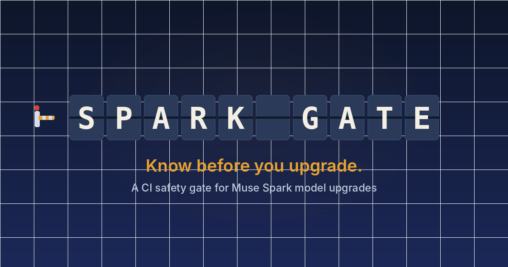
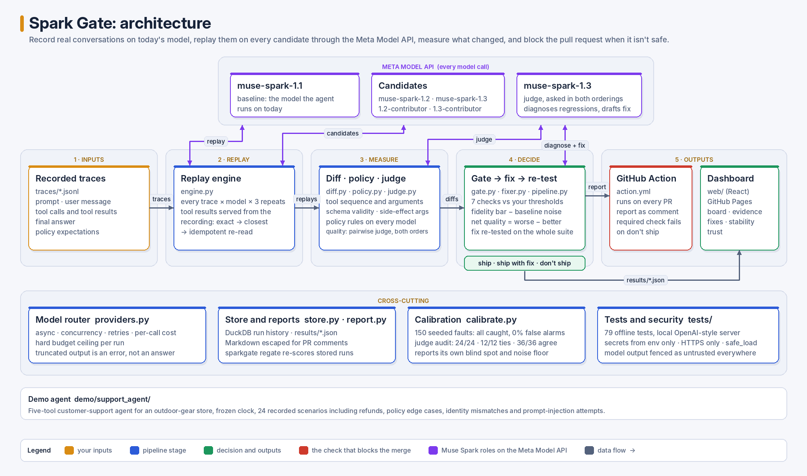

<p align="center">
  
</p>

<h1 align="center">Spark Gate</h1>

<p align="center"><strong>Know before you upgrade.</strong><br>
A CI safety gate for Muse Spark model upgrades: replay your agent's real conversations on the next model version or the cheaper endpoint, measure exactly what changed, and block the pull request when it isn't safe.</p>

<p align="center">
  <a href="https://demonjd2026-afk.github.io/spark-gate/"><strong>Live dashboard</strong></a> ·
  <a href="https://github.com/demonjd2026-afk/spark-gate/pull/1"><strong>Blocked pull request</strong></a> ·
  <a href="https://youtu.be/If_7ALm4S4k"><strong>Demo video</strong></a> ·
  <a href="#quickstart"><strong>Quickstart</strong></a>
</p>

<p align="center">
  <a href="https://github.com/demonjd2026-afk/spark-gate/actions/workflows/ci.yml"></a>
  <a href="https://github.com/demonjd2026-afk/spark-gate/actions/workflows/pages.yml"></a>
  
  
  <a href="LICENSE"></a>
</p>

Built by [Jayanth Dolai](https://www.linkedin.com/in/jayanth-dolai-7b115213a/) for the
**Meta Global AI Developer Hackathon** (Indie developer track, *Build for Your World*).
All code in this repository was written during the hackathon's building period
(Oct 26 – Nov 4, 2026); the commit history shows when each part landed.

## Demo video

[](https://youtu.be/If_7ALm4S4k)

**[▶ Watch on YouTube (2:59)](https://youtu.be/If_7ALm4S4k)** — the problem, the departure board, why Spark 1.3 was held, the auto-drafted fix, stability and trust, and the GitHub Action blocking a real pull request.

## Contents

- [Demo video](#demo-video)
- [At a glance](#at-a-glance)
- [Architecture](#architecture)
- [Where Meta's models are used](#where-metas-models-are-used)
- [The problem](#the-problem)
- [Results from real runs](#results-from-real-runs)
- [How it works](#how-it-works)
- [Quickstart](#quickstart)
- [The demo agent](#the-demo-agent)
- [Can you trust the gate?](#can-you-trust-the-gate-sparkgate-calibrate)
- [Configuration](#configuration)
- [GitHub Action](#github-action)
- [Security](#security)
- [Project layout](#project-layout)
- [Tests](#tests)
- [What's next](#whats-next)
- [Limitations](#limitations)

## At a glance

| | |
|---|---|
| **What it answers** | Is it safe to move this agent to `muse-spark-1.2`, `1.3`, or the contributor endpoint? |
| **Evidence** | Your agent's own recorded conversations, replayed on every candidate (3× each) with tool results served from the recording |
| **Seven checks** | Run errors · tool-call fidelity · policy rules · output schema · net judged quality · p95 latency · cost, each against a threshold you set |
| **Verdict** | **ship**, **ship with fix**, or **don't ship**, posted on the pull request by a GitHub Action that fails the required check |
| **Self-diagnosis** | Muse Spark 1.3 groups regressions, explains them, drafts a prompt fix, and the fix is re-tested on the whole suite before it counts |
| **Self-test** | 150 seeded faults caught 100%, 0% false alarms; judge audit 24/24 · 12/12 · 36/36; the gate reports its own noise floor |
| **Stack** | Python 3.11 (async router, DuckDB, JSON Schema), GitHub Action, React + Vite dashboard on GitHub Pages, 79 offline tests |

## Architecture



Left to right: recorded traces go into the replay engine, which runs every conversation on
the baseline and each candidate (three times each) with tool results served from the
recording; the diff, policy and judge stages measure what changed; the gate applies your
thresholds, asks Muse Spark to diagnose and draft a fix, re-tests the fix on the whole
suite, and issues the verdict; the GitHub Action and the dashboard are where the verdict
lands. Every model call, baseline, candidates, judge and fixer, goes through the Meta Model
API. [How it works](#how-it-works) walks the same pipeline stage by stage, with the
design decision behind each one.

## Where Meta's models are used

| Role | Model | Served by |
|---|---|---|
| Baseline: the version the agent runs on today | `muse-spark-1.1` | Meta Model API |
| Upgrade candidates | `muse-spark-1.2`, `muse-spark-1.3` | Meta Model API |
| Lower-cost candidates | `muse-spark-1.2-contributor`, `muse-spark-1.3-contributor` | Meta Model API (contributor endpoint) |
| Pairwise quality judge (position-swapped) | `muse-spark-1.3` | Meta Model API |
| Regression diagnosis and prompt-fix proposals | `muse-spark-1.3` | Meta Model API |
| The demo agent being tested | whichever model is under test | Meta Model API |

The same 24 conversations run on every model, so the report answers two practical
questions side by side: *is the next Muse Spark version safe for this agent?* and *can
it move to the much cheaper contributor endpoint without breaking?*

---

## The problem

Muse Spark has three versions you can call by name today (`muse-spark-1.1`, `1.2`,
`1.3`). For a team running an agent on one of them, upgrading is a guess: a newer model
may skip a policy check, call tools in a different order, or stop returning valid JSON.
Benchmarks don't tell you any of that about *your* agent. Spark Gate answers the
question with your own traffic.

Meta also serves each version on a contributor endpoint at a fraction of the price,
in exchange for using the traffic to improve its products. Whether *your* agent
behaves the same there is the same kind of question, and Spark Gate answers it the
same way.

## Results from real runs

24 conversations recorded on `muse-spark-1.1`, then replayed on four candidates through
the Meta Model API. The headline run replays every conversation **3 times** per model
(run `66a5de5acb63`, 72 replays per candidate, 65 minutes, **$13.47**). Every number
below comes from the reports committed in [`results/`](results/) and is on the
[dashboard](https://demonjd2026-afk.github.io/spark-gate/).

| Candidate | Verdict | What the gate found (pooled over 72 replays) |
|---|---|---|
| `muse-spark-1.2` | ✅ Ship | Every check passed: tool fidelity 89% against a threshold of 82% (90% less the baseline's own 8% drift), net quality +1%, 0.81× the cost. |
| `muse-spark-1.3` | ⛔ Don't ship | p95 latency 2.12× today's. Tool fidelity and quality were fine. The proposed prompt fix did not change that. |
| `muse-spark-1.2-contributor` | ⛔ Don't ship | Policy rules broken and invalid JSON on 7% of replays (threshold 5%), at 0.04× the cost. |
| `muse-spark-1.3-contributor` | ⛔ Don't ship | p95 latency 2.47× today's, at 0.05× the cost. |

Two findings from the runs shaped the gate itself:

- **One replay is not enough.** Three earlier single-replay runs of the same suite gave
  three different verdicts for `muse-spark-1.2` (cleared, then held on fidelity, then
  held on quality), and the baseline disagreed with its own recording on 4%, 12% and 8%
  of conversations. Reasoning models are not deterministic at temperature 0. That is why
  `runtime.repeats` exists and why the dashboard shows every run side by side.
- **A judge's "worse" rate is mostly noise.** Across the pooled run the judge called the
  candidate worse on 17-21% of replays and *better* on 17-24%. Net, there was no shift.
  The gate therefore scores *judged worse minus judged better*, and the fidelity threshold
  is lowered by the baseline's measured drift. `sparkgate regate` re-applies the rules to
  stored runs without new model calls, which is how the earlier runs were re-scored.

Calibration on the same traces caught 100% of 150 seeded faults with 0% false positives,
and the judge audit scored 24/24, 12/12 and 36/36 (see below).

## How it works

The [architecture diagram](#architecture) shows the components. This table walks the
same pipeline stage by stage, with the design decision behind each one and the module
that implements it, so a reviewer can go straight from a claim to the code.

| Stage | What it does | Why it is built this way |
|---|---|---|
| **Replay** (`engine.py`) | Re-runs each conversation on every model with the same tools. Tool results come from the recording, matched by exact args, then closest args (Jaccard over flattened `path=value` pairs, ≥ 0.5), then idempotent re-reads; anything else gets a deterministic `tool_unavailable` error. | Deterministic, side-effect-free comparison: no refund is issued twice, and every model sees the same world. |
| **Baseline re-run + noise floor** | The baseline is replayed too, and compared against its own recording. | Candidates are compared with a fresh baseline run, not a stale recording, and you see how much the baseline drifts on its own. |
| **Diff** (`diff.py`) | Tool sequence (multiset missing/extra, reorder), changed arguments, JSON Schema validity of the final answer, latency, cost. | Pure functions, no model calls: the parts that can be measured exactly are. |
| **Judge** (`judge.py`) | Muse Spark compares baseline vs candidate twice, in both orders. A winner counts only if both orders agree; otherwise it is a tie. | Removes position bias. Responses are fenced as untrusted data; judge output must parse into a fixed shape. |
| **Gate** (`gate.py`) | Tool fidelity, schema validity, policy pass rate, net quality loss, p95 latency ratio, cost ratio, run errors, each against thresholds in `sparkgate.yaml`. | A check with no data (unpriced model, judge disabled) is reported as *skipped*, never filled with a made-up number. Two checks are measured against the models' own noise: the fidelity threshold is lowered by the baseline's measured drift against itself, and quality counts *judged worse minus judged better*, because a judge choosing between near-equal answers picks each side about equally often. |
| **Policy expectations** (`policy.py`) | Optional per-trace rules: tools that must / must not be called, call order, argument bounds (e.g. refund ≤ the item price), allowed values in the final answer, and text that must never be revealed. Checked on the baseline *and* every candidate. | Comparing against the baseline alone can't catch a mistake the baseline already makes. A rule the baseline also breaks isn't counted as a regression, but the absolute check still blocks the ship, and the report lists what production already gets wrong. |
| **Side-effect arguments** (`diff.py`) | Tools listed under `gate.side_effect_tools` (refunds, tickets) are compared argument by argument, ignoring free-text fields such as `reason`. | A changed search query is harmless; a changed refund amount isn't. |
| **Diagnose & fix** (`fixer.py`) | Regressions are grouped deterministically by primary code (e.g. `dropped_tool:check_refund_eligibility`). Muse Spark explains each group and proposes a short system-prompt addendum. | The model never decides which traces belong together; it only explains a group it is given. |
| **Verify** (`pipeline.py`) | Each fix is replayed on the traces it targets; accepted fixes are then applied *together* and the whole suite is re-run and re-gated. | A fix that repairs one pattern but breaks other traces cannot let a model through. |
| **Repeats** (`runtime.repeats`) | Every trace is replayed N times on every model, the baseline included. Each candidate replay is diffed against the baseline replay of the same repeat, and every rate pools all N × traces pairs. | Reasoning models are not deterministic even at temperature 0, and on 24 traces one changed answer moves a rate by 4 points. Three single replays of this suite gave three different verdicts for the same model (see below); pooled replays make the rates stable enough to gate on. |

## Quickstart

```bash
python -m venv .venv && source .venv/bin/activate
pip install -e ".[app,dev]"
cp .env.example .env    # fill META_API_KEY, then: set -a; . ./.env; set +a

# 1. Record real traces of the demo support agent on the current production model
python -m demo.support_agent.record --model muse-spark-1.1 --out traces/support_agent.jsonl

# 2. Check config + traces without spending anything
sparkgate validate

# 3. Run the gate (exit code 0 = pass, 1 = fail, 2 = config/input error)
#    The config replays every trace 3 times per model; --repeats 1 is a quick, noisier look.
sparkgate run --markdown report.md

# 4. Measure the gate itself (offline; add --judge to audit the judge model)
sparkgate calibrate

# 5. Explore the result locally
streamlit run app/dashboard.py
#    or the published dashboard: cd web && npm ci && npm run dev

# Changed a threshold? Re-score a stored run without spending anything
sparkgate regate latest --write
```

Other commands: `sparkgate report latest`, `sparkgate history`,
`sparkgate run --candidate muse-spark-1.3` (gate one model), `--repeats 1` (one replay
per trace), `--fail-on not_ship` (also fail on *ship with fix*).

## The demo agent

`demo/support_agent/` is a tool-calling support agent for a fictional outdoor-gear
store, with five tools (`lookup_order`, `check_refund_eligibility`, `issue_refund`,
`create_ticket`, `search_help_center`), a written refund policy, a strict JSON
output schema, and policy expectations for every scenario. The backend enforces its own rules (30-day window, final sale, $200
specialist limit, identity match), and its clock is frozen so recordings are
reproducible. The 24 scenarios include straightforward refunds, policy edge cases,
identity mismatches and two prompt-injection attempts, which is where model upgrades
tend to regress.

## Can you trust the gate? (`sparkgate calibrate`)

A gate is only useful if it catches what it claims to and stays quiet otherwise.
`sparkgate calibrate` measures that on your own traces, offline and free:

1. Each recorded run is copied and one known fault is seeded into the copy: a skipped
   tool call, two calls swapped, a side-effecting call repeated or given a different
   argument, a broken JSON answer, a wrong outcome in the answer, a forbidden tool
   called. A fault is only seeded where it isn't already present.
2. The copy goes through exactly the same diff and policy checks a real candidate gets.
3. The report gives the detection rate per fault type, which check caught it, and the
   **false-positive rate** on unchanged copies (which must be 0%).

It also reports one known blind spot instead of hiding it: a changed argument on a
read-only tool (e.g. looking up the wrong order) isn't flagged by the deterministic
checks, only by the judge.

`sparkgate calibrate --judge` also audits the judge model (a few cents of API calls).
For each trace it pairs the real answer with another customer's answer (a sound judge
prefers the real one in both orderings) and with a re-serialised copy of itself (a
sound judge calls it a tie), and reports how often the two orderings agreed. On the
demo traces, `muse-spark-1.3` preferred the real answer 24 of 24 times, never preferred
the wrong one, called the re-serialised copy a tie 12 of 12 times, and its two orderings
agreed 36 of 36 times ($0.39).

The demo's expectations are themselves tested (`tests/test_demo_spec.py`). A rule-based
agent that follows the written policy satisfies every expectation against the real
backend, and an agent that refunds without the eligibility check fails them.

## Configuration

Everything lives in [`sparkgate.yaml`](sparkgate.yaml): baseline, candidates, endpoints,
per-model pricing, judge/fixer models, gate thresholds and runtime limits (concurrency,
retries, timeouts, a hard **budget ceiling** per run).

A candidate whose endpoint has no key set is skipped and listed as skipped in the
report; pass `--strict` to fail instead. `sparkgate validate` shows which models are
ready. The cost check uses the per-token prices in the config; a model with no price
has its cost check skipped rather than filled with a guessed number. Any
OpenAI-compatible endpoint can be added under `endpoints` and `models`.

If an endpoint rejects a request parameter, adjust `runtime`:
`temperature: null` omits temperature; `max_tokens_param: max_completion_tokens`
renames the output-length parameter; `reasoning_effort` is only sent when set.

Bring your own traces: one JSON object per line, matching `Trace` in
[`schemas.py`](src/sparkgate/schemas.py).

## GitHub Action

```yaml
- uses: actions/checkout@3d3c42e5aac5ba805825da76410c181273ba90b1 # v7.0.1
  with: { persist-credentials: false }
- uses: demonjd2026-afk/spark-gate@main
  env:
    META_API_KEY: ${{ secrets.META_API_KEY }}
  with:
    config: sparkgate.yaml
    candidates: muse-spark-1.3
```

The action writes the report to the job summary, posts it as a PR comment, and fails
the job on *don't ship*. See [`.github/workflows/sparkgate.yml`](.github/workflows/sparkgate.yml).

## Security

- Secrets only come from environment variables, are held as `SecretStr`, and never
  appear in config, logs or reports. Endpoints must be HTTPS (plain HTTP only for
  localhost).
- Trace files are size- and count-limited and validated with strict schemas;
  YAML is loaded with `safe_load`.
- Output schemas are validated with an explicit empty `$ref` registry, so an untrusted
  schema can never make Spark Gate fetch a URL.
- All model output is treated as untrusted: fenced and labelled as data in judge and
  fixer prompts, HTML-escaped in the dashboard, and Markdown/HTML/@mention-escaped in PR
  comments.
- DuckDB statements are parameterised throughout.
- The Action passes inputs to the shell only through environment variables (no `${{ }}`
  in scripts), pins third-party actions to commit SHAs, uses least-privilege
  permissions, and skips fork PRs, which have no access to secrets.
- A per-run spend ceiling stops new model calls once reached; failed runs are reported,
  not hidden.

## Project layout

```
spark-gate/
├── src/sparkgate/                 the gate (installed as the `sparkgate` CLI)
│   ├── schemas.py                 domain models: traces, replays, diffs, verdicts, reports
│   ├── config.py                  sparkgate.yaml loader + secrets from the environment
│   ├── providers.py               async model router: endpoints, concurrency, retries, cost, budget
│   ├── engine.py                  agent loop + recorded-tool oracle (no side effect runs twice)
│   ├── diff.py                    behavioral diff: tool sequence, arguments, schema, regression codes
│   ├── policy.py                  per-trace policy expectations, checked on every model
│   ├── judge.py                   position-swapped pairwise quality judge
│   ├── gate.py                    metrics, thresholds (noise-aware), ship / don't-ship decision
│   ├── fixer.py                   deterministic regression grouping + Muse Spark diagnosis and fix
│   ├── pipeline.py                orchestration: replay → diff → judge → gate → fix → re-test
│   ├── calibrate.py               seeded-fault calibration of the gate + judge audit
│   ├── store.py                   DuckDB run history + JSON reports
│   ├── report.py                  Markdown report for PR comments (escaped)
│   └── cli.py                     run · regate · calibrate · validate · report · history
│
├── demo/support_agent/            the agent under test
│   ├── agent.py                   five-tool customer-support agent (any Muse Spark model)
│   ├── backend.py                 fictional store backend: orders, refund rules, frozen clock
│   ├── scenarios.jsonl            24 scenarios with policy expectations
│   └── record.py                  records real traces on the production model
│
├── traces/support_agent.jsonl     the recorded conversations the gate replays
├── results/                       committed gate reports (one JSON per run) + calibration
├── sparkgate.yaml                 baseline, candidates, prices, thresholds, repeats, budget
├── action.yml                     the GitHub Action
│
├── web/                           dashboard (React + Vite + TypeScript) → GitHub Pages
│   ├── scripts/sync-data.mjs      copies results/ and traces/ into the site at build time
│   ├── src/App.tsx                page shell: hero, CI band, how-a-verdict-is-made, footer
│   ├── src/Board.tsx              the departure board (one row per candidate)
│   ├── src/Evidence.tsx           checks matrix + cost-vs-quality chart
│   ├── src/Fixes.tsx              regression patterns, prompt addendum, before/after
│   ├── src/Conversations.tsx      baseline vs candidate, side by side, with the judge's reason
│   ├── src/Stability.tsx          verdicts across runs, pooled rates with intervals
│   ├── src/Trust.tsx              calibration and judge-audit results
│   └── public/                    link-preview image + the synced data
│
├── app/dashboard.py               Streamlit dashboard for local exploration
├── tests/                         79 offline tests (scripted models + a local OpenAI-compatible server)
├── docs/architecture.png          the architecture diagram above
└── .github/workflows/
    ├── ci.yml                     ruff + pytest on every push and PR
    ├── sparkgate.yml              runs the gate on pull requests that touch the agent or config
    └── pages.yml                  builds and deploys the dashboard
```

## Tests

```bash
ruff check . && pytest -q
```

The suite runs fully offline: scripted models drive the real pipeline end to end, and
a local OpenAI-compatible HTTP server exercises the router's wire format, retries,
cached-token pricing and budget ceiling through the real OpenAI SDK.

## What's next

- Publish the Action on the GitHub Marketplace so any repo running a Muse Spark agent can
  add the gate with a few lines of YAML.
- Gate on confidence intervals rather than point rates, so a candidate near a threshold
  is reported as "not enough evidence" instead of a coin-flip verdict.
- Record traces straight from production logs instead of a scripted demo agent.

## Limitations

- Replay serves recorded tool results, so a candidate that asks for data the baseline
  never fetched gets a `tool_unavailable` error. Spark Gate counts these calls
  (`unrecorded_calls`) instead of hiding them.
- The quality judge is itself a model. Position swapping removes order bias but not
  every bias; the deterministic checks (tools, schema, cost, latency) carry the gate.
- Prompt fixes are suggestions verified by replay, not guarantees on unseen traffic.
- Calibration measures the checks against the fault types it seeds; a fault type it
  doesn't model isn't covered by its numbers.
- The models are not deterministic, so neither is the gate. `repeats` narrows the
  spread and the noise floor shows how much the baseline disagrees with itself, but a
  candidate sitting right at a threshold can still land on either side of it.

## License

MIT
